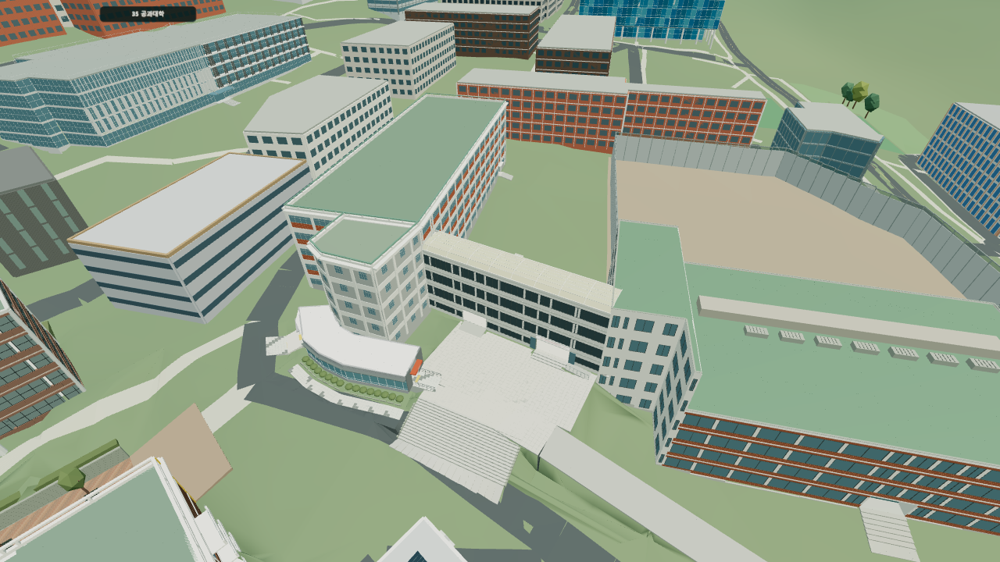

# Campus Smash

비공식 개인 창작물입니다. 서울대학교가 개발하거나 후원한 공식 게임이 아닙니다. 파괴 장면은 가상의 게임 표현이며 실제 시설이나 인물에 대한 위해를 의도하지 않습니다. 이 고지가 타인의 권리를 사용할 허락이나 법적 책임의 면제를 뜻하지는 않습니다.

[자료 이용 조건](public/data/LICENSE.txt), [배포 라이브러리 고지](public/licenses/NOTICE.txt), [법적 위험 검토](public/legal-review.html)를 함께 확인해 주세요. 사진이나 설계도에 접근할 수 있다는 사실만으로 복제나 재배포가 허용되지는 않습니다. 출처 기록은 이용허락 증명서가 아닙니다. 상표 사용 허락, 사진과 도면을 참고한 모델의 권리관계, 등급분류 면제 요건은 추가 확인 대상입니다.

**서울대학교 관악캠퍼스를 걸어 다니며 대포로 건물과 차량을 부수는 3D 웹게임입니다.**

교내 셔틀 정류장 중 시작할 곳을 골라 익숙한 건물을 찾아가거나, 다른 정류장으로 바로 이동해 둘러볼 수 있습니다. 도로에는 시내버스와 학교 셔틀, 택시와 승용차가 다닙니다. 설치 없이 브라우저에서 실행하며 PC와 모바일 조작을 모두 지원합니다.

**[게임 바로 하기](https://jhlee1020lee.github.io/3d-School_Crash/)** | [기존 배포 주소](https://snu-gate-campus-break.lee1010202001.chatgpt.site/) | [문제 제보](https://github.com/jhlee1020lee/3d-School_Crash/issues)



위 이미지는 게임 장면입니다. 실제 사진이나 실측 모델은 아닙니다. 캠퍼스 전체의 기본 배치를 갖추고 건물 외관과 건물 사이 통로를 구역별로 보완하고 있습니다. 서울대학교의 공식 게임이나 안내 서비스가 아닌 개인 프로젝트입니다.

## 처음 플레이한다면

1. 게임 주소를 열고 첫 화면의 **시작 위치**에서 교내 셔틀 정류장을 고릅니다. 로딩 중에도 미리 선택할 수 있습니다.
2. 준비가 끝나면 **선택한 위치에서 시작**을 누릅니다. 정류장을 선택해야 시작 버튼이 활성화됩니다.
3. 주변을 걸어 다니며 시점을 돌려 보고, 건물이나 차량을 향해 대포를 발사합니다.
4. 다른 구역이 궁금하면 미니맵을 누르거나 PC에서 `M`을 눌러 정류장으로 이동합니다.
5. 상단 복원 버튼을 누르면 파괴 상태와 점수가 초기화되고 선택한 정류장으로 돌아갑니다.

첫 로딩에는 지도와 지형을 읽고 3D 장면을 만드는 시간이 필요합니다. 시작 버튼 아래에서 현재 준비 중인 항목을 확인할 수 있습니다. 모바일에서 화면이 끊기면 상단 그래픽 품질을 **낮음**으로 바꿔 주세요. 앱 안의 브라우저에서 조작이 불편하면 휴대폰의 일반 브라우저에서 주소를 열어 보세요.

## 관리자 접속 통계

[관리자 통계 화면](https://snu-gate-campus-break.lee1010202001.chatgpt.site/stats.html)에서 별도 관리자 암호로 확인합니다. 게임 페이지 접속과 실제 탐험 시작을 구분하고 최근 30일의 일별 방문 브라우저 추정치, PC와 모바일 및 배포 주소별 합계를 제공합니다. 이어하기는 같은 페이지에서 새 시작으로 중복 집계하지 않습니다. 건물별 파괴 순위는 벽이나 지붕 등 일부가 처음 파괴되면 건물당 1회를 기록하며, 캠퍼스를 초기화하기 전까지 같은 건물을 중복 집계하지 않습니다. 전체 붕괴 횟수는 아닙니다. 지도에 등록된 건물 번호가 있는 대상만 포함하며, 최근 30일의 두 주소 기록을 합산합니다. 브라우저의 Do Not Track과 Global Privacy Control 신호는 존중합니다. 두 주소와 기기 사이의 동일 인물은 구분하지 못하며 과거 접속을 소급 집계하지 않습니다.

게임과 GitHub Pages는 같은 Sites API로 집계 요청을 보냅니다. 관리자 암호의 SHA-256 값은 Sites의 `ANALYTICS_ADMIN_HASH` 비밀 환경변수로 설정하며 암호 원문은 저장소와 배포 파일에 넣지 않습니다. 암호 변경 후에는 Sites 재배포가 필요합니다. 집계 장애는 게임 시작을 막지 않습니다. [수집 항목과 집계 기준](public/privacy.html)를 확인해 주세요.

Sites 배포는 `dist/client`의 게임 파일과 `dist/server`의 API, D1 마이그레이션을 함께 사용합니다. GitHub Pages에서는 기존처럼 `dist`에 정적 게임 파일을 만듭니다. `node scripts/verify-analytics.mjs`는 SQLite로 집계, 중복 요청, 입력 검증, 관리자 인증과 보존 기간을 검사합니다.

## 조작법

| 동작 | PC | 모바일 |
| --- | --- | --- |
| 이동 | `WASD` 또는 방향키 | 왼쪽 화면을 누른 채 밀기 |
| 달리기 | `Shift` | 별도 버튼 없음 |
| 시점 회전 | 마우스 이동 | 오른쪽 화면 드래그 |
| 점프 | `Space` | 점프 버튼 |
| 대포 발사 | 왼쪽 클릭 또는 `F` | 발사 버튼 |
| 지도와 빠른 이동 | `M` 또는 미니맵 클릭 | 미니맵 누르기 |
| 처음 상태로 복원 | `R` 또는 상단 복원 버튼 | 상단 복원 버튼 |
| 일시정지 | `Esc` 또는 상단 정지 버튼 | 상단 정지 버튼 |

모바일 이동 패드는 손가락을 댄 위치에 나타나며, 멀리 밀수록 빠르게 움직입니다. 점프 버튼을 누르고 있으면 착지한 뒤 다시 점프합니다. 이동하면서 시점을 돌리거나 발사 버튼을 함께 누를 수 있습니다.

PC에서 마우스 잠금이 허용되지 않으면 마우스를 누른 채 드래그해 시점을 바꾸고 `F`로 발사할 수 있습니다. 상단 버튼으로 소리를 끄거나 켤 수 있습니다.

## 현재 들어 있는 것

- **캠퍼스 탐험:** 지도에 근거한 건물 배치, 도로와 보행로, 높낮이가 있는 지형, 미니맵과 현재 위치 표시.
- **대포와 파괴:** 이동하는 포탄, 충돌과 폭발 효과, 부서지는 건물 부품과 차량, 파편과 점수, 원상복구.
- **교통:** 5511, 5513, 5516, 관악02 버스와 학교 셔틀, 택시와 일반 승용차. 확인한 노선의 교내 구간과 방향을 반영합니다.
- **정류장 이동:** 시작 화면과 일시정지 화면에서 교내 셔틀 정류장 15곳을 선택합니다.
- **주변 시설:** 정류장 표지와 쉼터, 신호등, 가로등, 볼라드, 보도블록과 점자블록. 건물별 현관, 차양, 계단, 경사로, 난간과 간판도 보완하고 있습니다.
- **모바일 대응:** 터치 이동과 시점 조절, 점프와 발사 버튼, 화면 크기 대응, 화질 설정과 파편 수 제한.

건물마다 구현 수준이 다릅니다. 중앙도서관과 관정관, 행정관, 미술관, 학생회관, 공대, 인문대, 사범대, 약대, 자연대와 생활관 등은 개별 자료를 대조해 외관이나 주변 통로를 보완했습니다. 최근에는 38동 글로벌공학교육센터의 아래층을 보완했습니다. 건축 도면을 대조해 열린 필로티와 서쪽 카페 및 로비, 가운데 낮은 마당을 구분했습니다. 현관 계단과 도로 보도, 선큰의 왕복 계단과 난간, 유리문과 영문 간판, 점자블록, 목재 데크와 가구도 추가했습니다. 넓은 상부를 3~5층으로 바로잡고 서쪽 부분 2층을 별도로 표현했습니다. 높이와 치수, 가구 배치 및 계단의 상하 시작점은 근사이며, 남쪽 주차 램프와 동쪽 부출입구는 추가 보완 대상입니다.

## 실제 캠퍼스와 다른 부분

지도에 있는 위치와 사진에서 확인한 외형을 바탕으로 만들지만, 사진만으로 알 수 없는 치수와 높이, 가려진 부분은 게임에 맞춰 추정합니다. 모든 건물의 실내를 구현하지 않았으며, 실제 모습과 다르거나 아직 빠진 통로와 계단도 있습니다.

버스의 교외 구간, 실시간 위치와 실제 배차 간격은 재현하지 않습니다. 사진 속 간판과 공사 현장은 촬영 당시 모습이며, 현재 영업 상태나 공사 진행 상황을 보증하지 않습니다. 게임을 실제 길찾기나 시설 안내에 사용하지 마세요.

브라우저의 모바일 화면과 터치 입력은 검사했지만, 여러 실제 휴대폰에서 장시간 플레이한 성능 결과는 아직 없습니다. 오래된 기기에서는 초기 로딩과 많은 파괴 효과가 부담이 될 수 있습니다.

## 내 컴퓨터에서 실행하기

게임은 [플레이 링크](https://jhlee1020lee.github.io/3d-School_Crash/)를 열면 바로 실행됩니다. 아래 과정은 소스를 수정하거나 개발 환경을 준비할 때 사용합니다.

개발 환경은 **Node.js 24 LTS**와 npm을 사용합니다. 실행에 별도 API 키나 서버 계정은 필요하지 않습니다. 캠퍼스 데이터는 저장소에 포함되어 있습니다.

```sh
git clone https://github.com/jhlee1020lee/3d-School_Crash.git
cd 3d-School_Crash
npm ci
npm run dev
```

터미널에 표시된 `Local` 주소를 브라우저에서 엽니다. 휴대폰으로 개발 중인 게임을 보려면 PC와 휴대폰을 같은 네트워크에 연결하고, 터미널의 `Network` 주소를 사용합니다. 방화벽이나 공유기 설정에 따라 접속이 제한될 수 있습니다. 외부에서는 GitHub Pages 주소를 사용하면 됩니다.

배포용 파일을 만들고 확인하려면 다음 명령을 실행합니다.

```sh
npm run build
npm run preview
```

`dev`와 `build`는 먼저 캠퍼스 형상을 계산해 압축 파일로 저장합니다. 첫 실행이나 모델 변경 후에는 이 과정에 시간이 걸립니다. 입력이 같으면 저장된 결과를 재사용합니다. 게임을 하는 브라우저는 이 파일을 불러오므로 캠퍼스 전체를 처음부터 생성할 필요가 없습니다. 형상 좌표와 재질, 파괴 기능을 유지하며, 사진 출처와 조사 기록은 소스에 남습니다.

개발 서버를 켠 채 건물이나 지형 코드를 수정했다면 다른 터미널에서 `npm run bake`를 실행해 모델 파일을 갱신합니다.

`build`는 TypeScript도 검사한 뒤 `dist/`에 정적 파일을 만듭니다. `preview`는 그 결과를 확인하는 로컬 서버입니다. `index.html` 파일을 더블클릭해 직접 여는 방식은 지원하지 않습니다.

## GitHub Pages 배포

[배포 워크플로](.github/workflows/pages.yml)가 `main` 브랜치에 변경 사항이 올라올 때마다 의존성을 설치하고 기본 검사를 실행한 뒤 게임을 빌드하고 배포합니다. 진행 상태와 오류는 저장소의 [Actions 탭](https://github.com/jhlee1020lee/3d-School_Crash/actions/workflows/pages.yml)에서 확인할 수 있습니다.

다른 계정으로 포크해 배포하려면 저장소의 **Settings → Pages → Build and deployment → Source**를 **GitHub Actions**로 설정하고, Actions 탭에서 워크플로를 실행합니다. 게임의 파일 경로는 상대 경로이므로 저장소 이름이 달라도 사용할 수 있습니다. README의 게임 주소와 저장소 링크는 본인 주소로 바꿔 주세요.

빌드 결과와 개발용 의존성은 Git에 올리지 않습니다. Pages에 필요한 `dist/`는 배포 과정에서 생성합니다. 설정 방식은 [GitHub Pages 공식 안내](https://docs.github.com/en/pages/getting-started-with-github-pages/using-custom-workflows-with-github-pages)와 [Vite 정적 배포 안내](https://vite.dev/guide/static-deploy.html)를 참고했습니다.

## 코드 구조

| 위치 | 역할 |
| --- | --- |
| `src/main.ts` | 데이터 로딩, 장면 생성, 게임 루프와 기능 연결 |
| `src/controls.ts`, `src/style.css`, `index.html` | PC와 터치 조작, 시작 및 이동 메뉴, 화면 구성 |
| `src/physics.ts`, `src/cannon.ts` | 플레이어 충돌, 파괴와 파편, 포탄과 폭발 |
| `src/fullCampus.ts`, `src/terrain.ts`, `src/distantBuildings.ts` | 캠퍼스 배치, 지형과 원거리 건물 표시 |
| `src/traffic.ts`, `src/transit*.ts` | 차량 운행, 노선과 정류장 시설 |
| `src/*Landmark.ts`, `src/*Exterior.ts`, `src/*Site.ts` 등 | 건물별 외관과 주변 통로, 계단 및 지형 보정 |
| `public/data/` | 게임이 읽는 캠퍼스, 지형, 버스 노선과 정류장 데이터 |
| `sources/` | 원본 지도, 건물 대응 관계, 사진 관찰과 추정 범위 기록 |
| `scripts/` | 데이터 변환과 기능별 검사 |
| `scripts/bake-campus.mjs`, `src/campusRuntime.ts` | 배포 전 캠퍼스 계산과 브라우저 로딩 |
| `docs/modeling-notes.md` | 건물별 모델링과 검증의 상세 기록 |
| `.github/workflows/pages.yml` | GitHub Pages 자동 배포 |

화면은 **Three.js**, 물리 계산은 **Rapier**, 코드는 **TypeScript**, 개발 서버와 빌드는 **Vite**를 사용합니다. 건물은 주로 코드로 기하 구조를 만들고 재질을 입힙니다. 거리뷰 사진을 그대로 게임 화면에 붙여 표시하는 방식은 아닙니다.

모바일 계산량을 줄이기 위해 먼 일반 건물의 메시를 구역별로 합치고, 가까운 구역을 중심으로 충돌체를 불러옵니다. 파괴 후 남은 건물은 멀어져도 유지하며, 파편과 효과 수에는 제한을 둡니다.

## 검사와 수정 방법

작은 변경을 확인할 때는 관련 검사만 실행할 수 있습니다.

```sh
npm run build
node scripts/verify-controls.mjs
node scripts/verify-runtime-coordinates.mjs
```

개발 저장소의 과거 이력이 있는 환경에서는 다음 명령으로 전체 검사를 실행합니다.

```sh
npm test
```

공개 저장소는 현재 소스를 첫 커밋으로 공개했으므로 일부 검사가 참조하는 과거 커밋을 포함하지 않습니다. 새로 복제한 환경에서 `npm test`를 실행하면 해당 이력 비교 검사에서 실패할 수 있습니다. 위의 기본 검사와 `node scripts/verify-engineering3033.mjs`, `node scripts/verify-engineering33.mjs`, `node scripts/verify-engineering3337.mjs`, `node scripts/verify-engineering37.mjs`, `node scripts/verify-engineering36.mjs`, `node scripts/verify-engineering3436.mjs`, `node scripts/verify-engineering3334.mjs`, `node scripts/verify-engineering35-access.mjs`, `node scripts/verify-engineering3736.mjs`는 과거 커밋 없이 실행할 수 있습니다.

전체 검사에는 실제 캠퍼스 장면을 생성하는 무거운 검사가 여러 개 들어 있어 시간이 오래 걸릴 수 있습니다. 물리와 파괴, 차량 경로, 정류장 이동, 원거리 표시, 지형과 건물별 통로를 다룹니다. 검사 목록과 실행 순서는 [verify-all.mjs](scripts/verify-all.mjs)에서 확인할 수 있습니다.

자동 검사는 좌표와 충돌, 입력 처리 등을 확인합니다. 일부 검사는 DOM과 렌더러를 시험용 객체로 바꾸므로 실제 화면이 잘 보이는지까지 보증하지 않습니다. 화면을 바꿨다면 브라우저에서 확인하고, 모바일 조작을 바꿨다면 터치 입력도 확인해 주세요.

건물이나 통로를 고칠 때는 `sources/`에 사진 주소와 촬영 시점, 직접 확인한 구조와 추정한 치수를 함께 기록합니다. 기존 OSM과 지형 원본은 보존하고 게임에서 필요한 보정은 별도로 적용합니다. 확인하지 못한 외관을 다른 건물의 특징으로 대신 채우지 않습니다.

## 자료와 이용 조건

- **건물 평면과 도로:** [OpenStreetMap](https://www.openstreetmap.org/relation/11917142), © OpenStreetMap contributors. [ODbL 1.0](https://www.openstreetmap.org/copyright)을 따릅니다. 원본은 [sources/campus.osm](sources/campus.osm), 변환 자료는 [public/data/campus.json](public/data/campus.json)에 있습니다.
- **지형:** [Mapzen / Tilezen Terrain Tiles](https://registry.opendata.aws/terrain-tiles/). USGS의 GMTED2010과 SRTM 자료를 포함하며, [원자료 출처와 이용 조건](https://github.com/tilezen/joerd/blob/master/docs/attribution.md)을 따릅니다. 게임용 지형에는 국소적인 높이 보정이 있습니다.
- **외관과 시설:** [서울대학교 공식 지도](https://map.snu.ac.kr/web/main.action), 공식 시설 안내, 설계 자료, 카카오맵 로드뷰, 네이버 거리뷰와 공개 웹 사진을 참고합니다. 개별 출처와 확인 범위는 [sources](sources/)와 [모델링 기록](docs/modeling-notes.md)에 구분합니다.
- **모바일 조작 참고:** [Roblox 모바일 입력 안내](https://create.roblox.com/docs/input/mobile)와 [공개 DynamicThumbstick 코드](https://github.com/Roblox/Core-Scripts/blob/master/PlayerScripts/StarterPlayerScripts/ControlScript/MasterControl/DynamicThumbstick.lua).

게임 안의 **지형과 자료** 링크에서도 [출처 안내](https://jhlee1020lee.github.io/3d-School_Crash/credits.html)를 볼 수 있습니다. 참고 사진과 로고, 상표의 권리는 각 권리자에게 있습니다. 참고 사진 자체는 공개 저장소의 게임 에셋으로 배포하지 않습니다.

아직 자체 코드의 사용 허락 범위를 정한 `LICENSE` 파일은 없습니다. 저장소 공개만으로 코드와 자료 전체의 자유로운 재배포를 허락하는 것은 아닙니다. 지도 데이터와 의존 라이브러리에는 각각의 이용 조건이 적용됩니다.

## 앞으로 보완할 부분과 제보

건물 사이 통로와 계단, 도로 접속부, 가까이서 보이는 현관과 외벽, 정류장 주변 시설을 계속 보완하고 있습니다. 모바일 성능과 충돌 오류도 함께 점검합니다.

막힌 통로나 실제와 다른 외관을 발견했다면 [이슈](https://github.com/jhlee1020lee/3d-School_Crash/issues)에 **건물 번호 또는 정류장 이름, 문제를 재현하는 방법, 사용 기기와 브라우저**를 적어 주세요. 비교할 사진이 있다면 공개 출처 링크와 촬영 시점도 도움이 됩니다. 위치가 드러나는 게임 스크린샷을 함께 남기면 확인하기 쉽습니다.
